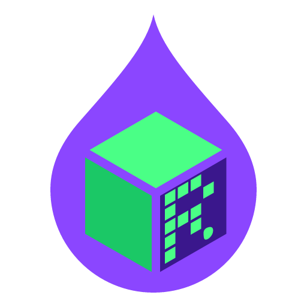
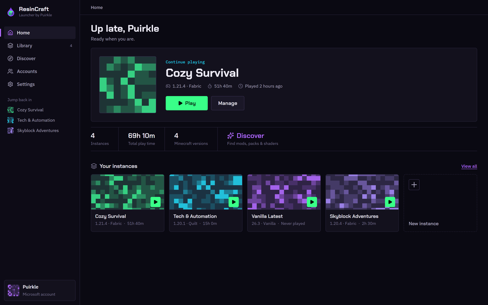
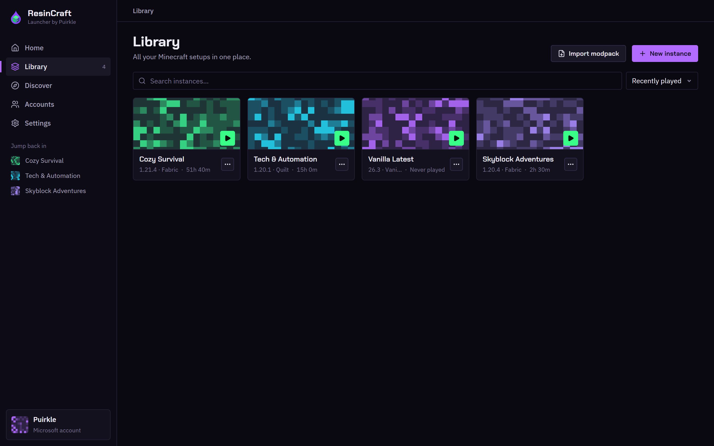
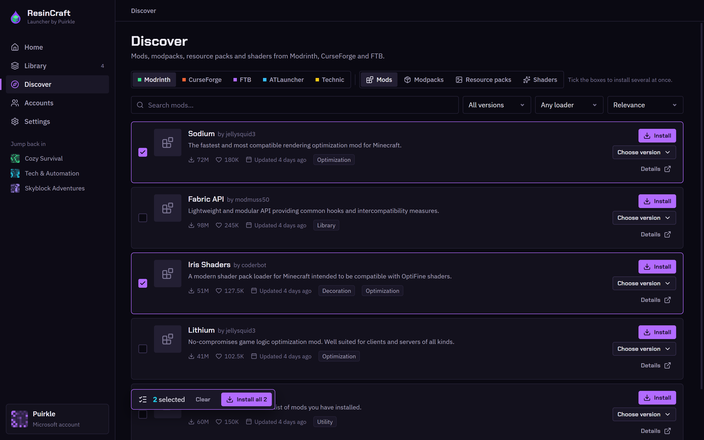

<div align="center">



# ResinCraft Launcher

A modern, friendly Minecraft: Java Edition launcher by **Puirkle of ResinCore**.

[](https://github.com/ResinCoreAI/ResinCraft-Launcher/releases/latest)

[](LICENSE)



</div>

A small native app built with Tauri 2 and Rust, with a React interface. It talks directly to the public Mojang, Microsoft, Fabric, Quilt, Forge, NeoForge, Modrinth, CurseForge and Adoptium APIs. No telemetry and no ResinCraft account.

> [!NOTE]
> ResinCraft supports **English and 15 more languages**, including the engine's error messages.

[Feature documentation in 16 languages](https://github.com/ResinCoreAI/ResinCraft-Launcher/tree/main/docs/features) · [English user guide](https://github.com/ResinCoreAI/ResinCraft-Launcher/blob/main/docs/guide/en.md)

## Why

Switching between a vanilla world, a modpack and a server with friends should be straightforward. ResinCraft keeps the setup in one place:

- **Keep each world separate.** Every instance has its own mods, saves, Java version and settings.
- **Find content without the extra steps.** Browse mods and modpacks across providers, with versions and dependencies handled for you.
- **Let Java take care of itself.** ResinCraft finds a compatible runtime or downloads one for your system.
- **Bring your friends.** Host a server on your computer and share an address through ResinCraft Relay or another supported route.

## Features

Feature overview for **[1.2.8](https://github.com/ResinCoreAI/ResinCraft-Launcher/commit/6fb49f47d70db49c4b083f88378ef168347b7bdc)**. See the [full English feature list](https://github.com/ResinCoreAI/ResinCraft-Launcher/blob/main/docs/features/en.md) for details.

| | |
|---|---|
| 🗂️ **Instances** | Separate installs per version or modpack, each with its own mods, worlds, Java, memory and JVM arguments. Groups, drag to arrange, icons, banners and colours. Copy worlds, mods, configs, packs and game settings between instances. Duplicate, open folder, delete to the Recycle Bin / Trash. |
| 🎮 **Any version** | Every release and snapshot from Mojang's manifest, back to the classic alphas, with legacy asset layouts handled. |
| 🧩 **Mod loaders** | Fabric, Quilt, Forge (back to Minecraft 1.2.5), NeoForge and LiteLoader, with a loader version picker. OptiFine, jar mods and custom version settings for main class, libraries, tweakers and arguments. Change an instance's Minecraft version or loader from Settings; the version chip opens it directly. |
| ⚡ **Quick join and worlds** | Jump straight into recent servers and singleplayer worlds. Play a world directly, rename it, back it up or import it from a zip. |
| 🔎 **Discover** | Mods, modpacks, resource packs and shaders from Modrinth, CurseForge, FTB, ATLauncher, Technic and GitHub releases, filtered to your instance. Search all providers at once or paste a link to install directly. |
| 📦 **Smart installs** | Install several items at once, add required dependencies automatically and check for duplicate mods across sources. |
| 🔧 **Mod management** | Enable or disable mods instantly, remove and update them, and recognise jars added by hand. Export mods, resource packs or shaders as a list and install that list into another instance. |
| 📥 **Manual downloads** | When CurseForge authors require a browser download, ResinCraft picks up the files from Downloads or your own watch folders in Settings → Downloads. |
| 🌍 **Modpacks** | Import Modrinth `.mrpack`, CurseForge, FTB, ATLauncher and Technic packs; export an instance as `.mrpack` or a CurseForge `.zip`, or make your own modpack. Pack pages show descriptions, galleries, versions, changelogs and included mods. Update packs or switch their versions. |
| 🚚 **Move from another launcher** | Import instances from Prism Launcher, MultiMC, Modrinth App, CurseForge, ATLauncher, GDLauncher or the official Minecraft Launcher, including mods, worlds, packs and settings. Import servers too. |
| ☕ **Java** | Detect installed runtimes, including the official launcher's, choose the right major version and download Eclipse Temurin for your system and CPU when needed. |
| 👤 **Accounts** | Microsoft sign-in on Microsoft's own page, without entering your password in ResinCraft. Multiple accounts, skins, capes and name changes. Tokens use Windows' data protection; on macOS and Linux, they stay in a file only your user can read. Offline profiles support singleplayer and LAN. |
| 🖥️ **Server hosting** | Vanilla, Paper, Purpur, Folia, Spigot, Leaf, Fabric, Quilt, Forge, NeoForge, Arclight and Bedrock Dedicated Server (Windows and x64 Linux), or a server from a modpack or instance. Console, properties, live players, plugin and mod updates, whitelist, ops, bans, icons and backups. Restart and more-actions menus, tuned Java flags or the modpack's own flags. |
| 🛡️ **Server mod handling** | Detect and disable client-only mods at each server start while preserving needed dependencies. If a remaining client-only mod crashes the server, disable it and restart automatically. |
| 🤝 **Share and approve players** | Share through your router, ResinCraft Relay, playit.gg, bore.pub or your own domain, with optional Cloudflare DNS automation. Bedrock players can join Java servers through Geyser + Floodgate. Accept or reject whitelist requests from a Relay web page or your own Discord bot (`/whitelist`); accepting adds the player to the whitelist, and Reject and block prevents further requests. |
| 🟩 **Bedrock Edition** | On Windows, install, launch and uninstall Minecraft for Windows or Minecraft Preview, with worlds backed up before uninstalling. View worlds and join your Bedrock servers. |
| 📁 **Files and notes** | Instance tabs for Content, Worlds, Servers, Screenshots, Notes, Files, Logs and Settings. A file manager and editor for every instance and server, plus launch/exit commands and environment variables. |
| ▶️ **Play** | Launch with another account or run the same instance twice with two accounts. Cancellable downloads, a live colour-coded log console with filter and copy, play-time tracking, and options to minimise or hide the launcher while playing. |
| 🩹 **Crash fixer** | Read crash reports and logs, explain likely causes and offer fixes: install a missing dependency, disable a crashing mod, choose the right Java or increase memory. Apply a fix only when you choose it. |
| 📊 **Memory and Discord** | See RAM use for the launcher, games and servers, optionally on Home. Discord Rich Presence shows the pack, version, play time and whether you are in singleplayer or on a server, with View modpack and Get ResinCraft buttons. |
| 🎨 **App and storage** | Light and dark themes, a storage manager to move data to another drive, and settings backup and restore. Keep running in the system tray so servers, your Discord bot and downloads continue after closing the window. |
| ⬆️ **Updates** | Signed in-app updates from GitHub releases, an Update button in the title bar, a choice to close running games and servers or wait, and optional silent updates. |
| 🌐 **Languages** | English and 15 more, including the engine's error messages. |

<p align="center">
  
  &nbsp;
  
</p>

## Requirements

| System | Supported platforms |
|---|---|
| **Windows** | Windows 10/11, x64, with Microsoft Edge WebView2. |
| **macOS** | macOS 10.15 or newer, Intel or Apple Silicon. |
| **Linux** | x64 or ARM64; choose the package for your distribution and architecture. |

- **Minecraft: Java Edition:** a Microsoft account that owns the game for online play. Offline profiles are available for singleplayer and LAN.
- **Java:** a compatible runtime for your Minecraft version. ResinCraft can find or download it for you.
- **Internet:** needed for sign-in, downloads, updates and sharing a server through a relay.
- **Apple Silicon:** Minecraft 1.19 and newer run natively; older versions use Rosetta 2. ResinCraft tells you if it is missing.
- **ARM Linux:** Minecraft 1.19 and newer are supported; older versions lack an ARM build of their graphics library.
- **Bedrock:** the Minecraft for Windows and Minecraft Preview page is Windows-only.

## Download

Get the newest version from the [latest release](https://github.com/ResinCoreAI/ResinCraft-Launcher/releases/latest):

| System | File |
|---|---|
| **Windows** x64 | `ResinCraft.Launcher_<version>_amd64_windows.exe` |
| **Windows** x64, MSI (managed installs) | `ResinCraft.Launcher_<version>_amd64_windows.msi` |
| **macOS** Intel and Apple Silicon | `ResinCraft.Launcher_<version>_universal_macos.dmg` |
| **Linux** x64, AppImage | `ResinCraft.Launcher_<version>_amd64_linux.AppImage` |
| **Linux** x64, Debian / Ubuntu / Mint | `ResinCraft.Launcher_<version>_amd64_linux.deb` |
| **Linux** x64, plain folder | `ResinCraft.Launcher_<version>_amd64_linux.tar.gz` |
| **Linux** ARM64 | The same three formats, with `_arm64_linux` instead of `_amd64_linux`. |

### Install

1. Download the file for your system and CPU.
2. On **Windows**, run the installer. On **macOS**, open the `.dmg` and move ResinCraft to Applications. On **Linux**, install the `.deb`, make the AppImage executable and run it, or unpack the `.tar.gz` and run `./resincraft`.
3. Open ResinCraft, add an account and create your first instance.

> [!IMPORTANT]
> Builds are not code-signed yet. Windows may show an unverified publisher or a SmartScreen warning; macOS may report an unidentified developer. On macOS, right-click the app and choose **Open** the first time. In-app updates are checked against ResinCraft's update signing key.

The installer, macOS app, AppImage and `.deb` support in-app updates. The Linux `.tar.gz` folder is updated by hand.

## Using it

| To… | Do this |
|---|---|
| **Start playing** | Create an instance in **Library**, choose a Minecraft version and loader, then press **Play**. |
| **Find mods or a modpack** | Open **Discover**, choose a provider or search all of them, then install into your instance. |
| **Manage an instance** | Open its settings to adjust Java, memory and JVM arguments, or manage its mods, worlds and files. |
| **Change the game or loader** | Click the instance's version chip to open **Settings → Version**, choose versions and press **Change version**. Check your mods for compatibility afterwards. |
| **Fix a crash** | Review the crash fixer's suggestions, then choose **Fix** or **Fix all and play again**. |
| **Play offline** | Add an offline profile for singleplayer or LAN. |
| **Host for friends** | Create a server under **Servers**, start it and choose a supported sharing route. |
| **Approve new players** | Open the server's **Players** tab to accept or reject requests from the Relay web page or your Discord bot. |
| **Move from another launcher** | Import its instances or servers, including their mods, worlds, packs and settings. |
| **Check for updates** | Use **Update** in the title bar or **Settings → Updates** to check, read release notes and choose automatic or silent updates. |

## ResinCraft Relay

**ResinCraft Relay is a ResinCore service**, operated through ResinCore's cloud infrastructure. It connects friends to a Minecraft server running on your computer without requiring you to forward router ports or asking players to install extra software.

Friends join using an address such as **`<name>.rscraft.resincore.tech`**. Their game traffic passes through the cloud relay to reach your local server; the world and server files stay on your computer. The launcher connects to the relay over TLS.

- **Game content:** the relay forwards connections without storing gameplay traffic, chat messages or world files.
- **Sign-in:** to claim an address, the launcher sends a Minecraft access token so the relay can verify ownership with Minecraft services. The relay does not store or log that token; it issues its own session token and stores only its hash.
- **Service records:** the relay stores Minecraft UUIDs and usernames, reserved addresses, session records, monthly traffic totals and bans to operate the service and enforce limits. Operational events include IP addresses in the admin dashboard; debug logs may include them too.

ResinCraft has no telemetry or ResinCraft account. Relay service records are used for running the relay, rather than launcher analytics. You can also share through your router, playit.gg or bore.pub.

This repository includes the [launcher-side relay client](relay/src/agent.rs). The hosted relay server is maintained separately from the launcher repository.

## Privacy & security

Your instances, worlds, mods, settings and saved accounts stay on your computer. The launcher contacts the services needed for the features you use, such as Microsoft for sign-in, content providers for downloads and GitHub for updates. Those services have their own privacy policies.

| | |
|---|---|
| **Microsoft sign-in** | You authenticate on Microsoft's own page. ResinCraft receives tokens, never your password. |
| **Local accounts** | Saved tokens use Windows' data protection on Windows; on macOS and Linux, the account file is restricted to your user. |
| **Cloud relay** | When you use ResinCraft Relay, connections pass through ResinCore's cloud service. Its content handling and service records are described [above](#resincraft-relay). |
| **Signed updates** | Downloads are checked against ResinCraft's update key and the version they were signed for before installation. |

Game data is stored in `%APPDATA%\ResinCraft Launcher` on Windows, `~/Library/Application Support/ResinCraft Launcher` on macOS and `~/.config/ResinCraft Launcher` on Linux.

## Updates

ResinCraft checks for updates shortly after it starts and every 6 hours. An **Update** button appears in the title bar when a version is available. **Settings → Updates** lets you check manually, read release notes and choose automatic or silent updates.

Updates replace the program while keeping your instances, accounts and settings. If a game or hosted server is running, choose **Close them and update**, wait until they stop, or cancel. **Update silently** downloads in the background and installs once no game or hosted server is running. ResinCraft restarts after installation.

## Build from source

Needs Node.js 24 and Rust (stable), plus per system:

- **Windows**: the Visual Studio C++ Build Tools (MSVC). WebView2 ships with Windows 10/11.
- **macOS**: Xcode's command-line tools (`xcode-select --install`).
- **Linux** (Debian/Ubuntu): `sudo apt install libwebkit2gtk-4.1-dev libgtk-3-dev libayatana-appindicator3-dev librsvg2-dev patchelf build-essential`.

```bash
npm install
npm run dev
```

- `npm run dev` starts the UI on Vite (port 1420) and the Rust engine in `src-tauri/`, with hot reload for the UI. Dev builds keep all game data in `.dev-data/` inside the project, so testing never touches a real install.
- `npm run build` builds this system's release files into `src-tauri/target/release/bundle/`: the NSIS installer on Windows, the `.app` and `.dmg` on macOS (`npm run build -- --target universal-apple-darwin` for one that runs on both CPUs), the `.AppImage` and `.deb` on Linux. Release CI builds all of them (`.github/workflows/release.yml`).
- `npm run dev:web` serves the UI alone at http://localhost:1420 with a mock engine and sample data, which is handy for design work.
- `npm run typecheck` / `npm run format`. Translations: `npx tsx tools/check-i18n.ts` and `npx tsx tools/engine-strings.ts --check`.
- Headless engine checks (inside `src-tauri/`): `cargo run --example smoke -- 1.21.1 fabric` creates a throwaway instance, downloads everything and boots Minecraft with an offline profile; also `check_content`, `check_player` and `check_server`.
- The ResinCraft Relay client is in `relay/`; run its library checks with `cargo test` there. The hosted Relay server is maintained separately. Headless checks for the newer launcher features include `check_crashfix`, `check_setversion`, `check_requests` and `check_discordbot` in `src-tauri/examples/`.

<details>
<summary>Developer setup, project layout and release notes</summary>

### Microsoft sign-in setup

Source builds need a Mojang-approved Azure application client ID for Microsoft sign-in. Official release builds can include ResinCraft's ID through `RESINCRAFT_MS_CLIENT_ID`; if your build has none, configure your own:

1. In the [Azure portal](https://portal.azure.com) go to **App registrations → New registration**.
   - Supported account types: **Personal Microsoft accounts only**.
   - No redirect URI is needed.
2. Under **Authentication**, set **Allow public client flows** to **Yes**.
3. Copy the **Application (client) ID**.
4. Submit the ID to Mojang for Minecraft API access: <https://aka.ms/mce-reviewappid>. Until it's approved, sign-in fails with a "rejected this app's Client ID" message.
5. Paste the ID in **Settings → Microsoft sign-in**, or set `RESINCRAFT_MS_CLIENT_ID` before launching.

### Project layout

```
src/
  shared/types.ts      Types + the engine API (ResinApi) the UI uses
  shared/bridge.ts     The channel map: every API call and the engine channel it goes to
  renderer/src/        React UI (pages/, components/, i18n/, styles.css)
    tauri-api.ts       Talks to the Rust engine
    mock.ts            Stands in for the engine in a plain browser (npm run dev:web)
src-tauri/             Tauri app and the Rust engine
  src/core             Context, events and tasks, downloads, paths, settings, instances, IPC router
  src/game             Versions, loaders, Java, launching
  src/content          Modrinth, CurseForge, FTB, ATLauncher, Technic, import/export
  src/player           Accounts, worlds, servers list, screenshots, notes
  src/server           Server hosting, tunnels, relay client, join requests and Discord bots
  src/files            File manager and editor
  examples/            Headless checks
relay/                 Launcher-side ResinCraft Relay client library
site/                  Website (Next.js)
deploy/windows/        Windows Server deployment for the website
docs/                  Features and user guides in 16 languages
tools/                 Translation checks
```

### Update internals and releasing

Installed copies use Tauri's updater (`src-tauri/src/updater.rs`, UI in `src/renderer/src/components/Updates.tsx`), the title-bar Update button and **Settings → Updates**. The update file is the release's NSIS installer itself on Windows, the `.app.tar.gz` on macOS and the `.AppImage` (or the `.deb`, for installs made from it) on Linux (`bundle.createUpdaterArtifacts`). It is checked against the public key in `tauri.conf.json` and must carry the version it was signed for (`requireSignedVersion`), so a tampered `latest.json` cannot pass off an older release as new. It installs over the program only (on Windows the installer runs in passive mode), preserving the data folder and restarting the new version. Manual updates offer to close running games and servers or wait; silent updates wait until none are running.

Where it looks (`plugins.updater.endpoints`): `https://raw.githubusercontent.com/ResinCoreAI/ResinCraft-Launcher/updates/latest.json`. The `updates` branch holds only that file. It's written by `.github/workflows/publish-update.yml` when a release is published (not a draft, not a pre-release, and only if it's the latest release), so a release reaches players only once its draft is published. The release itself then shows just the installer: the `.sig` is removed (its text is inside `latest.json`), and so is `latest.json`, except on releases up to 1.2.10, because launcher 0.3.0 still looks for it on the newest release.

**Signing key.** `updater.local.key` (the private key, password-protected) and `updater.local.env` (its password) sit next to `keys.local.env` and are git-ignored. **Back both up**: installed copies only accept updates signed with this key. CI reads them from the repository secrets `TAURI_SIGNING_PRIVATE_KEY` and `TAURI_SIGNING_PRIVATE_KEY_PASSWORD`; locally, export them before `npm run build:tauri`:

```bash
set -a; . ./updater.local.env; set +a; export TAURI_SIGNING_PRIVATE_KEY="$PWD/updater.local.key"
```

**Releasing an update.**

1. Bump the version in `package.json`, `src-tauri/Cargo.toml` and `src-tauri/tauri.conf.json`.
2. Push a tag (`git tag v1.2.10 && git push origin v1.2.10`). CI builds on Windows, macOS and Linux (x64 and ARM) and makes a draft release with the downloads listed under [Download](#download), the macOS update file `…_universal_macos.app.tar.gz`, and `latest.json`, which carries the signed update for every platform (`windows-x86_64`, `darwin-aarch64` / `darwin-x86_64`, `linux-x86_64`, `linux-aarch64`, and `-deb` entries for `.deb` installs). Running **Release** from the Actions tab builds the same files as the run's artifacts, with no release.
3. Publish the draft on GitHub. That is the rollout: **Publish update** copies `latest.json` to the `updates` branch, and players get the update at their next check (start, or within 6 hours). If that workflow fails, re-run it from the Actions tab (Run workflow, with the tag).

**Testing an update locally.** Build an older and a newer copy under a separate name, so the test never touches a real install or its data (`RESINCRAFT_DATA_FOLDER` is read at build time):

```bash
RESINCRAFT_DATA_FOLDER="ResinCraft Update Test" npx tauri build --config update-test.json
```

with `update-test.json` setting `productName`, `mainBinaryName`, `identifier`, `version`, and `plugins.updater` = `{ "endpoints": ["http://127.0.0.1:18765/latest.json"], "dangerousInsecureTransportProtocol": true }`. Install the older one, put the newer setup.exe and a `latest.json` (version, url, and the `.sig` text as `signature`) in a folder served on that port, and start the older copy.

### Code signing (Windows "Publisher: unverified")

Windows shows **Publisher: unverified** and SmartScreen warnings for unsigned installers. Fixing it needs a code-signing certificate issued to you (Puirkle); no app setting can do it. Options: SignPath Foundation (free, open-source projects), Certum Open Source Code Signing (individuals), Microsoft Azure Artifact Signing (cheapest commercial, limited regions for individuals), or a standard OV/EV certificate.

Once you have one, add it to `src-tauri/tauri.conf.json` and every `npm run build:tauri` signs automatically:

- Certificate installed in Windows (token or .pfx):
  ```json
  "bundle": { "windows": { "certificateThumbprint": "<SHA1 thumbprint>", "digestAlgorithm": "sha256", "timestampUrl": "http://timestamp.digicert.com" } }
  ```
- Cloud signing (Azure Artifact Signing, SimplySign, …): use `"bundle": { "windows": { "signCommand": "<tool> sign … %1" } }`, where `%1` is the file to sign.

Signed builds show "Puirkle" as the publisher immediately; SmartScreen's warning fades as the signed installer gains download reputation.

</details>

## ☕ Support our work

However, if you enjoy my software and would like to directly support Puirkle, you can do so here:

- 🇹🇭 **Thai support** (Thai only): [https://ezdn.app/puirkle](https://ezdn.app/puirkle)
- ☕ **Buy Me a Coffee:** [https://buymeacoffee.com/puirkle](https://buymeacoffee.com/puirkle)

Support creators at ResinCore:

- ☕ **Buy Me a Coffee:** [https://buymeacoffee.com/resincore](https://buymeacoffee.com/resincore)

## 📜 License

[AGPL-3.0-only](LICENSE) Copyright © 2026 ResinCore. All rights reserved. Created by Puirkle

ResinCraft Launcher is licensed under the GNU Affero General Public License v3.0 only (AGPL-3.0-only). Commercial use and paid hosting are permitted under the license. Source-code obligations apply as described in the license.

> NOT AN OFFICIAL MINECRAFT PRODUCT. NOT APPROVED BY OR ASSOCIATED WITH MOJANG OR MICROSOFT.
